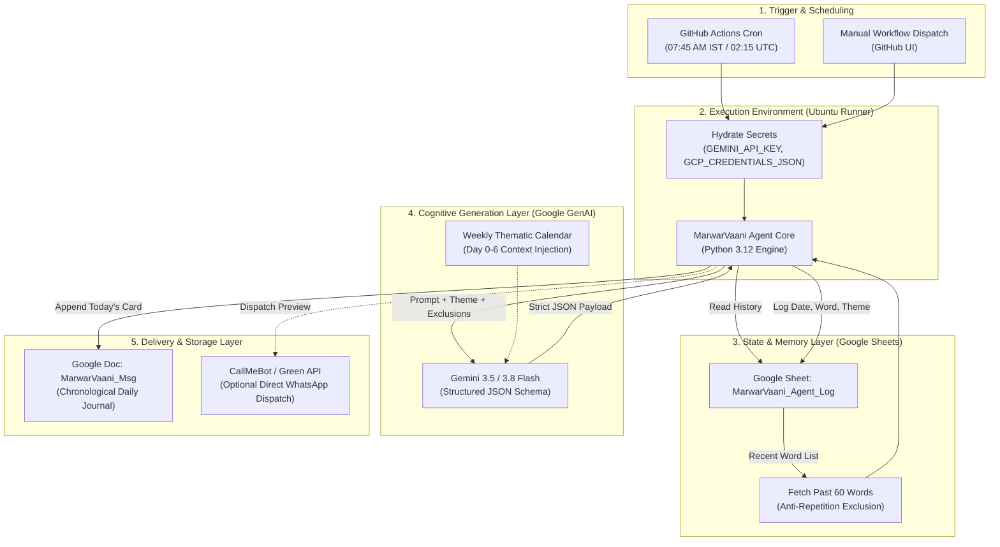
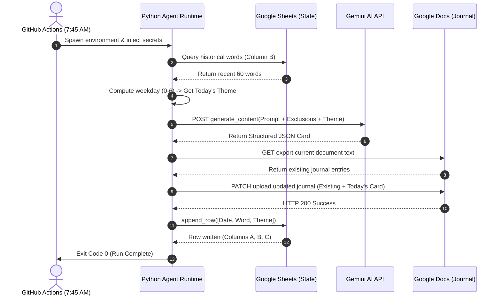
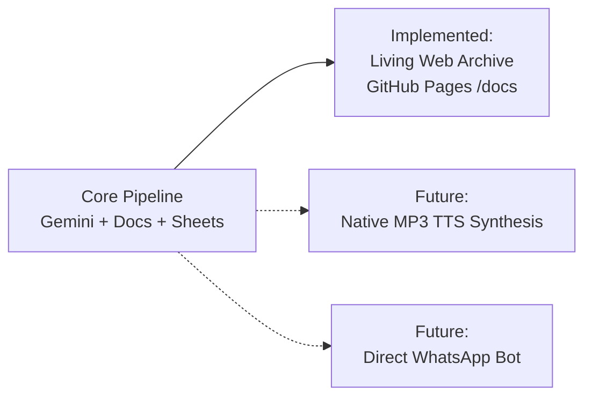

# 🏛️ MarwarVaani: Architecture & System Design Document

> **System Blueprint & Technical Reference for Project MarwarVaani**  
> *A Serverless, State-Aware, AI-Powered Cultural Preservation Pipeline*

---

## 1. Executive Summary

**Project MarwarVaani** is an autonomous micro-service designed to preserve and celebrate the Rajasthani/Marwari dialect. It generates daily, contextually themed cultural cards containing vocabulary, colloquial expressions, cultural background, conversational dialogues, and family prompts.

The system is built on a **100% serverless, zero-maintenance architecture** utilizing GitHub Actions for scheduled orchestration, Google Gemini for cognitive generation, and Google Workspace (Sheets & Docs) for persistence, deduplication, and publishing.

---

## 2. High-Level System Architecture

The following diagram illustrates the end-to-end cloud infrastructure and data flow:



---

## 3. Detailed Component Architecture

### A. Orchestration Layer (GitHub Actions)
* **Runner:** Ephemeral Linux Virtual Machine (`ubuntu-latest`).
* **Trigger Mechanism:**
  * **Cron Trigger:** `15 2 * * *` (02:15 AM UTC = 07:45 AM Indian Standard Time).
  * **Event Trigger:** `workflow_dispatch` allows immediate on-demand testing directly from the GitHub Actions console.
* **Secret Injection:** Zero credentials stored on disk. At startup, GitHub Actions securely injects `GEMINI_API_KEY`, `GCP_CREDENTIALS_JSON`, `GOOGLE_DOC_ID`, and `GOOGLE_SHEET_NAME` into process memory.

### B. State & Deduplication Layer (Google Sheets API)
* **Purpose:** Acts as a lightweight, human-auditable database.
* **Mechanism:**
  1. Authenticates using a Google Cloud Service Account (`credentials.json` or `GCP_CREDENTIALS_JSON`).
  2. Reads Column B (`Word`) across the last 60 records.
  3. Feeds these words into Gemini's exclusion list, preventing repeating terms over a 2-month window.
  4. Post-generation, appends `[Date, Word, Theme]` across Columns A, B, and C.

### C. Cognitive Generation Layer (Google Gemini 3.5 / 3.8 Flash)
* **Engine:** Google GenAI SDK (`google-genai`).
* **Persona & Framing:** Role-conditioned as an authentic Rajasthani cultural linguist and family educator.
* **Strict JSON Enforcement:** Uses `response_mime_type="application/json"` to ensure output matches the schema deterministically without markdown wrapping issues.
* **Multi-Model Failover:** Automatically queries `gemini-3.5-flash-lite` first, and gracefully falls back to `gemini-3.8-flash` in case of high-demand spikes (HTTP 503).

### D. Presentation & Journaling Layer (Google Drive API / Google Docs)
* **Target:** `MarwarVaani_Msg` Google Doc.
* **Mechanism:**
  * Fetches current document body using Drive API (`/export?mimeType=text/plain`).
  * Decodes text with `utf-8-sig` to safely strip byte-order marks (BOM).
  * Appends the new day's card with a standardized header banner and divider.
  * Uploads via Drive API media upload (`text/plain; charset=utf-8`).

---

## 4. End-to-End Sequence Diagram



---

## 5. Key Data Schemas

### 1. Gemini JSON Output Schema
```json
{
  "word_devanagari": "झूठो मेह",
  "word_transliteration": "Jhootho Meh",
  "theme": "Desert Life & Nature (Maru-Dhara / Prakriti)",
  "item_type": "Phrase",
  "meaning": "A false cloud or mirage of rain that disappears without showering.",
  "cultural_vibe": "Captures the hopeful yet testing relationship Marwaris have with desert monsoon clouds.",
  "dialogue_marwari": "आज तो आकाश में घणी बदळियां छाई है, पण इण मूळ धूप में तौ लागे 'झूठो मेह' ही निकळसी।",
  "dialogue_english": "Today the sky is full of clouds, but in this scorching heat, it feels like it's just a false rain cloud.",
  "family_prompt": "Have you ever experienced a desert mirage or a false rain cloud during your visits to Rajasthan?"
}
```

### 2. Google Sheet Log Structure (`MarwarVaani_Agent_Log`)
| Column A (`Date`) | Column B (`Word`) | Column C (`Theme`) |
| :--- | :--- | :--- |
| `2026-10-31` | `धोरां रा धणी` | `Desert Life & Nature (Maru-Dhara / Prakriti)` |
| `2026-10-31` | `झिझवा` | `Desert Life & Nature (Maru-Dhara / Prakriti)` |
| `2026-10-31` | `लू री लपेट` | `Desert Life & Nature (Maru-Dhara / Prakriti)` |

### 3. Weekly Thematic State Machine
```python
THEME_SCHEDULE = {
    0: "Kitchen, Food & Street Snacks (Ransoi, Chatkara & Mitthan)",
    1: "Daily Expressive Words (Bhaav-Boli)",
    2: "Humor, Jibes & Teasing (Mehna-Tona / Thitholi)",
    3: "Customs, Rituals & Superstitions (Reet-Rivaz & Shagun)",
    4: "Classic Idioms & Witty Sayings (Kahawat & Muhavra)",
    5: "Personalities & Quirky Habits (Aadmeyan Ri Fitrat)",
    6: "Vintage Artifacts & Sunday Wisdom (Ghar Ri Cheezan & Gyan)"
}
```

---

## 6. Key Design Decisions & Engineering Patterns

| Challenge / Decision | Technical Solution | Benefit |
| :--- | :--- | :--- |
| **Serverless State Management** | Using Google Sheets via `gspread` instead of a persistent database server (e.g. Postgres). | Zero hosting cost, zero database maintenance, human-readable audit log. |
| **Model Availability Spikes** | Multi-tier failover (`gemini-3.5-flash-lite` $\rightarrow$ `gemini-3.8-flash`). | Prevents job failures during temporary 503 high-demand periods. |
| **Safe Dry-Run Testing** | Parameterized `--dry-run` and `--save-log` CLI flags. | Allows testing AI prompts and formatting without polluting production sheet history. |
| **UTF-8 Multi-byte Characters** | `sys.stdout.reconfigure(encoding="utf-8")` + `utf-8-sig` decoding. | Clean display of Devanagari script and emojis across Windows and Linux runners. |
| **Zero-Secret Codebase** | GCP Credentials loaded via stringified JSON in CI/CD, local file in dev. | Repository can be public without exposing service account keys. |

---

## 7. Future Extensibility Roadmap



1. **Web Archive & Dictionary [IMPLEMENTED]:** Serves a responsive, searchable dictionary from `/docs` via GitHub Pages with auto-sync from `docs/data/cards.json` on every run.
2. **Audio Voice Synthesis [FUTURE]:** Generate native `.mp3` audio pronunciations and host them alongside cards.
3. **Direct WhatsApp Group Dispatch [FUTURE]:** Transition from Google Doc staging to automated WhatsApp group broadcasting via Green API / Meta Cloud API.

